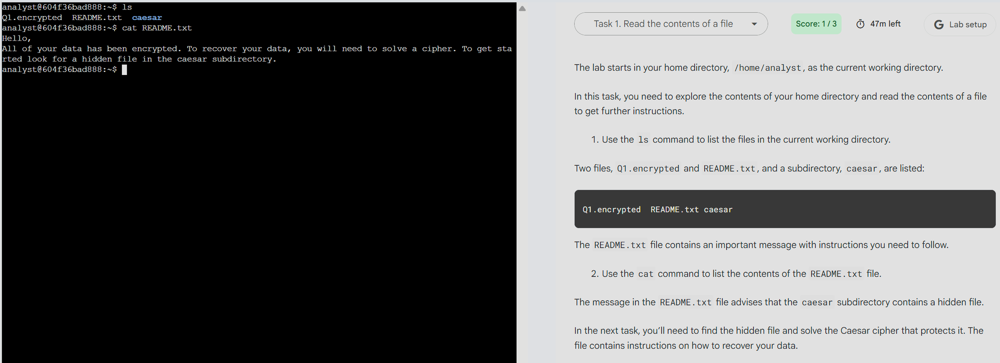
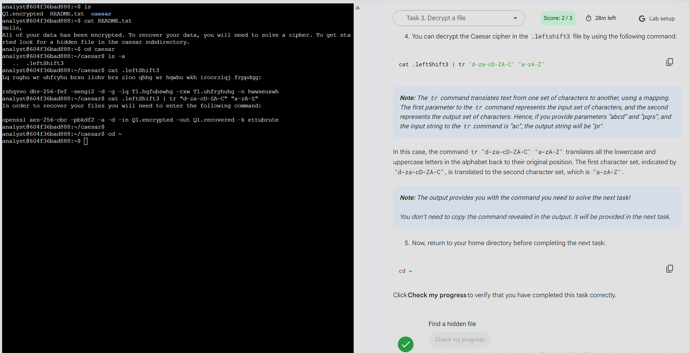
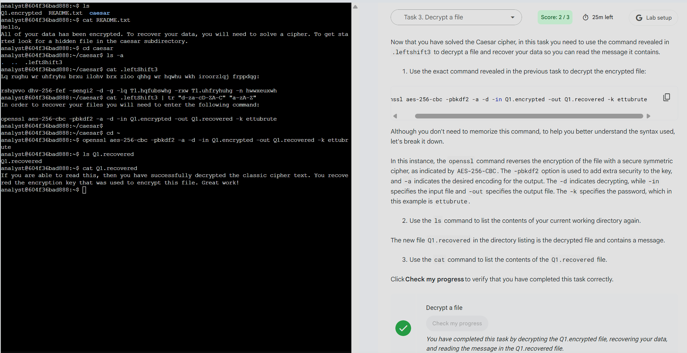

# Decrypt an Encrypted Message

**Course:** Google Cybersecurity Certificate - Course 5 (Assets, Threats, and Vulnerabilities)
**Tools:** Linux Bash and OpenSSL

Find the hidden `.leftShift3` clue, reverse its Caesar shift with `tr`, then use its OpenSSL instructions to decrypt `Q1.encrypted`.

```bash
cat .leftShift3 | tr "d-za-cD-ZA-C" "a-zA-Z"
openssl aes-256-cbc -pbkdf2 -a -d -in Q1.encrypted -out Q1.recovered -k ettubrute
cat Q1.recovered
```

### Screenshots







**Takeaway:** `ls -a` reveals hidden clues; the Caesar cipher reveals the command needed to decrypt the AES-encrypted message.
