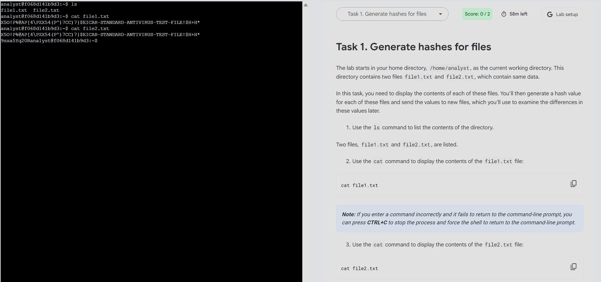
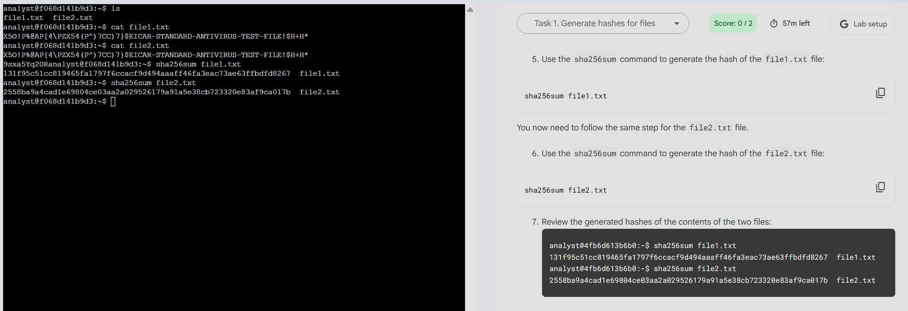
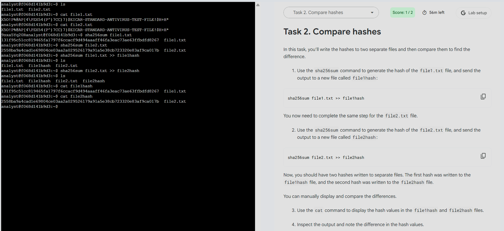
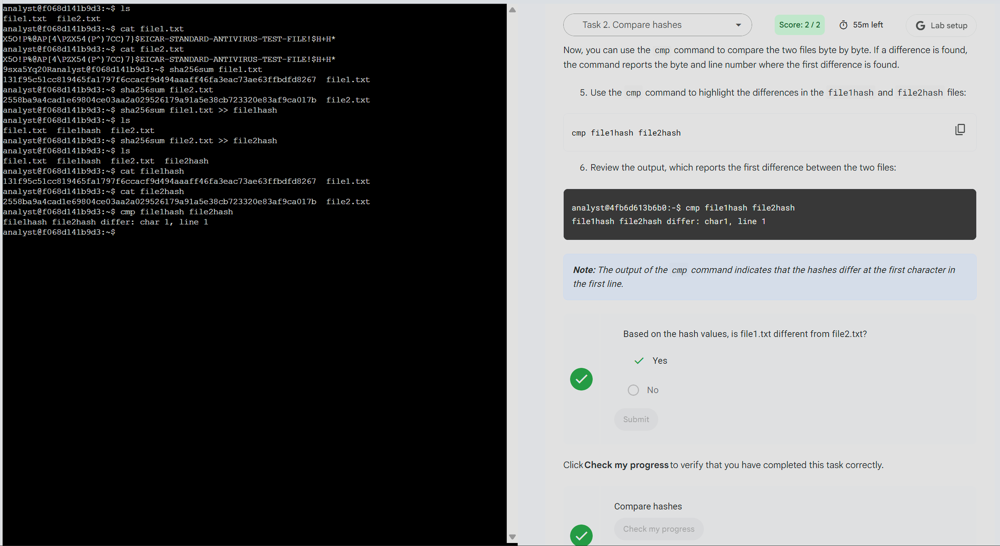

# Activity: File Integrity Verification and Hash Comparison

- **Course:** Google Cybersecurity Certificate - Course 5 (Assets, Threats, and Vulnerabilities)
- **Platform:** Google Skills
- **Category:** File Integrity and Cryptographic Hashing
- **Environment:** Linux CLI, working directory `/home/analyst`
- **Tools Used:** `ls`, `cat`, `sha256sum`, `>>`, `cmp`

## Scenario

Two files in `/home/analyst` contain almost the same EICAR test string. The task is to inspect both files, generate SHA-256 hashes, and compare the saved hash records to determine whether either file has changed.

## Objective

Inspect two files, calculate and save their SHA-256 hashes, then compare the results to identify whether their contents match.

## Methodology

### 1. Inspect the Files

Listed the home directory and checked both text files. `file1.txt` contained the standard EICAR antivirus test string. `file2.txt` contained that same string with `9sxa5Yq20R` appended and no trailing newline.

```bash
ls
cat file1.txt
cat file2.txt
```



### 2. Calculate SHA-256 Hashes

Generated a SHA-256 digest for each file:

```bash
sha256sum file1.txt
sha256sum file2.txt
```

```text
131f95c51cc819465fa1797f6ccacf9d494aaaff46fa3eac73ae63ffbdfd8267  file1.txt
2558ba9a4cad1e69804ce03aa2a029526179a91a5e38cb723320e83af9ca017b  file2.txt
```



### 3. Save the Hash Records

```bash
sha256sum file1.txt >> file1hash
sha256sum file2.txt >> file2hash
ls
cat file1hash
cat file2hash
```



### 4. Compare the Hash Records

Compared the saved records byte by byte:

```bash
cmp file1hash file2hash
```

`cmp` reported:

```text
file1hash file2hash differ: char 1, line 1
```



## Result

The SHA-256 digest values differ, confirming that the file contents are not identical. Each `sha256sum` record also includes its source filename, so the digest values themselves are the evidence of a content change.

## Takeaway

Cryptographic hashes provide a quick way to detect file changes: even a small appended string produces a different SHA-256 digest.
